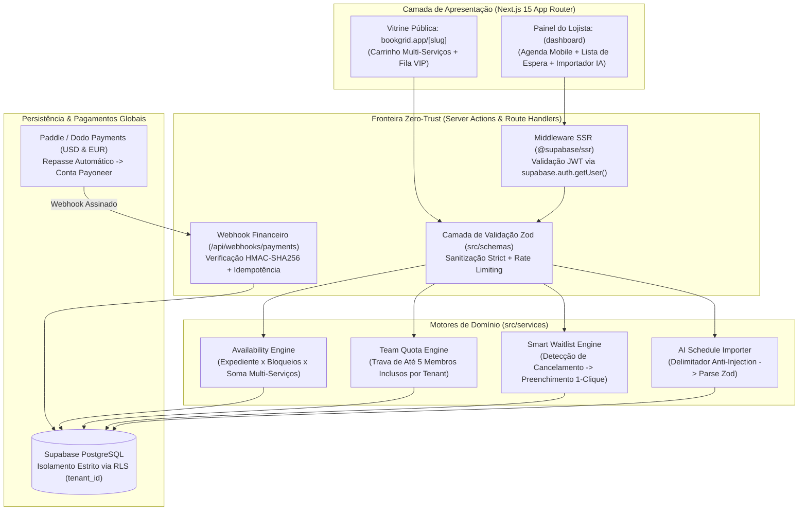

# 🏛️ ARCHITECTURE.md — Especificação de Arquitetura de Software do BookGrid

> **Produto:** **BookGrid** (`bookgrid.app/[slug]`)  
> **Empresa:** **GilByte Solutions**  
> **Arquitetura:** Multi-Tenant SaaS (Clean Architecture + Next.js 15 App Router + Supabase RLS)  
> **Moedas Suportadas:** Exclusivamente **USD ($)** e **EUR (€)** via **Paddle / Dodo Payments ➔ Payoneer**

---

## 1. Stack Tecnológica Oficial

| Camada | Tecnologia | Função Arquitetural |
| :--- | :--- | :--- |
| **Framework Core** | **Next.js 15 (App Router)** | React Server Components (RSC), Server Actions, Route Handlers e Middleware Edge. |
| **Linguagem** | **TypeScript 5.x (Strict Mode)** | Tipagem estática rigorosa (`strict: true`, `noUncheckedIndexedAccess: true`), zero `any`. |
| **Estilização & UI** | **Tailwind CSS** | Interface Mobile-First de alta performance para operação com uma mão no celular. |
| **Banco & Auth** | **Supabase (PostgreSQL 17 + Auth + RLS)** | Persistência relacional Multi-Tenant com isolamento via Row Level Security e `@supabase/ssr`. |
| **Validação & Contratos** | **Zod** | Validação Zero-Trust no servidor para formulários, rotas, webhooks e saídas de IA. |
| **Billing Global (MoR)** | **Paddle / Dodo Payments ➔ Payoneer** | Cobrança recorrente exclusiva em **USD ($29/mo)** e **EUR (25€/mo)** com repasse ACH/SEPA para Payoneer. |
| **Motor de IA** | **LLM Structured Outputs (Gemini / OpenAI)** | Extração determinística de horários a partir de texto do WhatsApp ou OCR de foto de agenda física. |

---

## 2. Diagrama de Arquitetura do Sistema



---

## 3. Estrutura de Pastas Profissional

```text
BookGrid/
├── .agent/
│   └── rules/
│       ├── 01-nextjs15-supabase-clean-arch.mdc
│       └── 02-owasp-security-guardrails.mdc
├── .cursor/
│   └── rules/
│       ├── 01-nextjs15-supabase-clean-arch.mdc
│       └── 02-owasp-security-guardrails.mdc
├── supabase/
│   └── migrations/
│       └── 0001_bookgrid_multitenant_rls.sql
├── src/
│   ├── app/
│   │   ├── (public)/
│   │   │   └── [slug]/
│   │   │       └── page.tsx               # Página pública bookgrid.app/[slug] (RSC + Cart Client Leaf)
│   │   ├── (dashboard)/
│   │   │   ├── layout.tsx                 # Guard de autenticação SSR (getUser + Tenant Context)
│   │   │   ├── agenda/
│   │   │   │   └── page.tsx               # Agenda Visual Mobile-First + Botão "Preencher Vaga"
│   │   │   ├── importer/
│   │   │   │   └── page.tsx               # Importador Mágico IA (Texto WhatsApp / Foto Agenda)
│   │   │   ├── team/
│   │   │   │   └── page.tsx               # Gestão de Equipe (Até 5 profissionais inclusos)
│   │   │   └── billing/
│   │   │       └── page.tsx               # Assinatura Global ($29 USD / 25 € EUR via Paddle/Dodo)
│   │   └── api/
│   │       └── webhooks/
│   │           └── payments/
│   │               └── route.ts           # Receptor HMAC-SHA256 do Paddle / Dodo Payments
│   ├── schemas/
│   │   ├── env.schema.ts                  # Validação estrita de variáveis de ambiente no boot
│   │   ├── tenant.schema.ts               # Regras de slug, moeda ('USD' | 'EUR') e expediente
│   │   ├── booking.schema.ts              # Validação do Carrinho Multi-Serviços e soma de duração
│   │   ├── waitlist.schema.ts             # Validação da Lista de Espera Inteligente
│   │   └── ai-import.schema.ts            # Schema determinístico para sanitizar a saída da IA
│   ├── services/
│   │   ├── availability/
│   │   │   └── slot-calculator.ts         # Algoritmo de janelas contínuas p/ múltiplos serviços
│   │   ├── waitlist/
│   │   │   └── vacancy-matcher.ts         # Motor de encaixe imediato após cancelamentos
│   │   └── ai-importer/
│   │       └── schedule-parser.ts         # Pipeline seguro de extração e sanitização via IA
│   └── lib/
│       └── supabase/
│           ├── client.ts                  # Browser client (@supabase/ssr) com chave pública anon
│           ├── server.ts                  # Server client (@supabase/ssr) com cookies HTTP-Only
│           └── admin.ts                   # Service Role client ('server-only') exclusivo p/ Webhooks
├── .env.example
├── .gitignore
├── AGENTS.md
├── ARCHITECTURE.md
└── SECURITY.md
```

---

## 4. Regras de Negócio Mapeadas do BookGrid

### 4.1. Motor de Disponibilidade & Carrinho de Múltiplos Serviços (`slot-calculator.ts`)
Diferente de ferramentas engessadas que aceitam apenas 1 serviço por agendamento, o **BookGrid** opera com um **Carrinho de Serviços**:
1. **Soma Automática no Servidor:** O cliente seleciona $N$ serviços ($S_1, S_2, \dots, S_n$). O servidor busca as durações e preços reais no banco (`price_usd` ou `price_eur`, nunca confiando no valor enviado pelo front-end):
   $$D_{\text{total}} = \sum_{i=1}^{n} \text{duration\_minutes}(S_i), \quad P_{\text{total}} = \sum_{i=1}^{n} \text{price}(S_i)$$
2. **Cálculo de Colisão de Janela Contínua:** Para um profissional $M$, data $d$ e expediente $[T_{\text{open}}, T_{\text{close}}]$, um horário candidato $t_{\text{start}}$ só é exibido como livre se o intervalo $[t_{\text{start}}, t_{\text{start}} + D_{\text{total}})$ não tiver interseção com:
   - Nenhum agendamento ativo (`status IN ('confirmed', 'recovered_from_waitlist')`) daquele profissional:
     $$[t_{\text{start}}, t_{\text{end}}) \cap [b_{\text{start}}, b_{\text{end}}) = \emptyset$$
   - Nenhum bloqueio manual de horário (*break/almoço*) cadastrado pelo profissional.

### 4.2. Lógica de Equipe Inclusa (Até 5 Membros por Tenant Sem Taxa Adicional)
1. **Regra de Quota Fixa (`max_staff_included = 5`):** Todo tenant ativo no plano único (**$29 USD/mês** ou **25 € EUR/mês**) tem direito a cadastrar até **5 profissionais ativos** sem custo extra por cadeira.
2. **Trava Dupla (Service + Database Trigger):** Antes de inserir um novo registro em `staff_members`, o sistema verifica `COUNT(*) WHERE tenant_id = X AND active = true < 5`. Caso o limite seja atingido, a camada de serviço e a trigger PostgreSQL bloqueiam a inserção com erro tipado `STAFF_QUOTA_EXCEEDED`.

### 4.3. Motor de Lista de Espera Inteligente Anti-Buracos (`vacancy-matcher.ts`)
Quando um agendamento confirmado no horário $[t_{\text{start}}, t_{\text{end}})$ com duração $D_{\text{liberada}}$ é alterado para `status = 'cancelled'`:
1. O motor consulta instantaneamente a tabela `waitlist_entries` daquele `tenant_id` filtrando por:
   - `status = 'waiting'`
   - `desired_date = booking_date`
   - `total_duration_minutes <= D_liberada` (garantindo que o combo desejado pelo cliente da fila cabe exatamente no buraco aberto sem atrasar o próximo cliente!).
2. O painel do lojista destaca o slot cancelado com a ação **"⚡ Preencher Vaga"**, que promove o registro da fila para um agendamento confirmado (`status = 'recovered_from_waitlist'`) dentro de uma transação atômica e gera o link de notificação instantânea para o cliente.

### 4.4. Fluxo de Importação Assistida por IA com Sanitização Rigorosa (`schedule-parser.ts`)
Para eliminar a barreira de migração do caderno de papel ou conversas do WhatsApp:
1. **Entrada Bruta:** O lojista envia um bloco de texto ou imagem da página do caderno.
2. **Isolamento de Prompt:** O servidor encapsula o conteúdo dentro de `<untrusted_schedule_input>` e solicita à IA a extração estruturada.
3. **Sanitização e Validação Zod (`AIImportedBookingArraySchema`):**
   - Cada item extraído passa por validação estrita: nome sanitizado contra tags HTML/XSS (`/[<>]/g`), telefone normalizado para padrão internacional E.164 (`^\+?[1-9]\d{6,14}$`), horário validado em formato 24h (`^([01]\d|2[0-3]):[0-5]\d$`) e duração limitada entre `10` e `480` minutos.
   - Os itens validados são apresentados em estado de *staging* para confirmação do lojista antes do `INSERT` em lote no Supabase.
